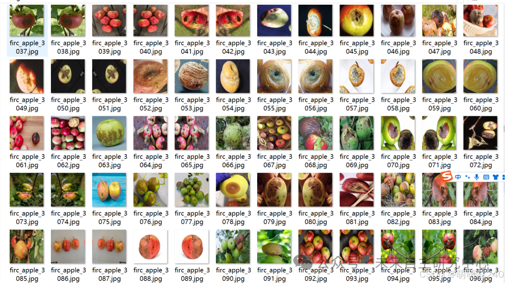
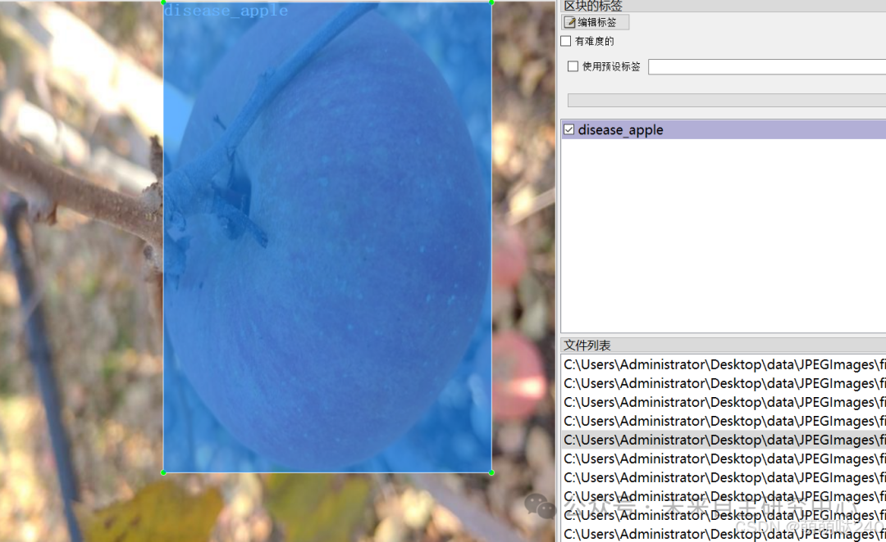

# [Dataset] Object Detection

Dataset format: Pascal VOC format + YOLO format (txt files without split paths, only containing jpg images and corresponding VOC format xml files and yolo format txt files)
Number of images (number of jpg files): 6970
Number of annotations (number of xml files): 6970
Number of annotations (number of txt files): 6970
Number of annotation categories: 4
Annotation category names: ["disease_apple", "good_apple", "rotten_apple", "soso_apple"]
Number of bounding boxes per category:
disease_apple = 1674
good_apple = 914
rotten_apple = 14556
soso_apple = 792
Total bounding boxes: 17936
Labeling tool used: labelImg
Annotation rules: Draw a rectangle around the category
Important note: No guarantee is made regarding the accuracy or weights of the trained models. The dataset provides accurate and reasonable annotations only.

Image Preview:

Annotation example:

## Payment

Here is a pay link on Stripe ( https://buy.stripe.com/3cs8yP7sY87d0vu9AB ). Please contact me lonlonago@foxmail.com after funding $89, and I will send you a complete data files , thank you!

